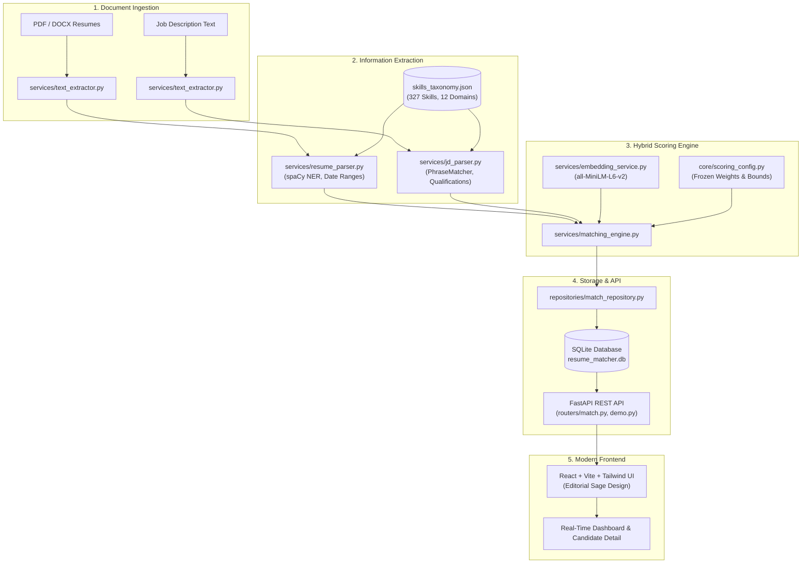

# AI-Based Resume Matching & Candidate Ranking System

> An explainable, production-ready AI platform that parses resumes, matches candidates against target Job Descriptions using hybrid semantic-lexical intelligence, and computes deterministic 0–100 match scores with auditable factor breakdowns.

[](https://fastapi.tiangolo.com)
[](https://react.dev)
[](https://tailwindcss.com)
[](https://spacy.io)
[](https://www.sbert.net)
[](https://opensource.org/licenses/MIT)

---

## 1. System Overview & Architecture

### Core Value Proposition
- **Hybrid Matching Intelligence:** Combines phrase-level hierarchical taxonomy matching with dense contextual embeddings (`all-MiniLM-L6-v2`) to eliminate false synonyms while rewarding genuine domain depth.
- **100% Explainable Scoring:** No black-box LLM hallucinations. Scores sum linearly across 5 weighted factors ($S_{\text{skill}} 40\%$, $S_{\text{sem}} 25\%$, $S_{\text{exp}} 20\%$, $S_{\text{qual}} 10\%$, $S_{\text{title}} 5\%$).
- **Domain Safeguards & Knockout Caps:** Automatically penalizes keyword stuffing and caps off-domain candidates below technical profiles.
- **Editorial UI Design:** Built with accessible design tokens, WCAG AA compliant typography (Anton, Fraunces, Inter), and real-time dashboard filtering.



---

## 2. Codebase Module Mapping

The system is organized into 5 cleanly decoupled modules corresponding to the system requirements:

| Module | Core Functionality | Primary Implementation Files |
|---|---|---|
| **Module 1: Text Extraction** | Multi-format parser (PDF, DOCX, TXT) with bounding-box multi-column layout sorting and table cell preservation. | [`backend/app/services/text_extractor.py`](file:///c:/Users/singh/OneDrive/Desktop/AI-Based%20Resume%20Matching%20%26%20Candidate%20Ranking%20System/backend/app/services/text_extractor.py)<br/>[`backend/app/services/resume_parser.py`](file:///c:/Users/singh/OneDrive/Desktop/AI-Based%20Resume%20Matching%20%26%20Candidate%20Ranking%20System/backend/app/services/resume_parser.py)<br/>[`backend/app/services/jd_parser.py`](file:///c:/Users/singh/OneDrive/Desktop/AI-Based%20Resume%20Matching%20%26%20Candidate%20Ranking%20System/backend/app/services/jd_parser.py) |
| **Module 2: Semantic Embeddings** | Dense vector similarity (`all-MiniLM-L6-v2`) with in-memory SHA-1 caching, requirement-unit coverage, and linear cosine calibration. | [`backend/app/services/embedding_service.py`](file:///c:/Users/singh/OneDrive/Desktop/AI-Based%20Resume%20Matching%20%26%20Candidate%20Ranking%20System/backend/app/services/embedding_service.py)<br/>[`backend/app/core/scoring_config.py`](file:///c:/Users/singh/OneDrive/Desktop/AI-Based%20Resume%20Matching%20%26%20Candidate%20Ranking%20System/backend/app/core/scoring_config.py) |
| **Module 3: Scoring & Ranking Engine** | 5-factor linear scoring ($S_{\text{skill}}$, $S_{\text{sem}}$, $S_{\text{exp}}$, $S_{\text{qual}}$, $S_{\text{title}}$), interval merging, family collapse, and knockout safeguards. | [`backend/app/services/matching_engine.py`](file:///c:/Users/singh/OneDrive/Desktop/AI-Based%20Resume%20Matching%20%26%20Candidate%20Ranking%20System/backend/app/services/matching_engine.py)<br/>[`backend/app/services/skills_taxonomy.py`](file:///c:/Users/singh/OneDrive/Desktop/AI-Based%20Resume%20Matching%20%26%20Candidate%20Ranking%20System/backend/app/services/skills_taxonomy.py) |
| **Module 4: REST API & Persistence** | FastAPI backend with SQLite repository pattern, one-click demo seeding, streaming CSV export, and stale run detection. | [`backend/app/main.py`](file:///c:/Users/singh/OneDrive/Desktop/AI-Based%20Resume%20Matching%20%26%20Candidate%20Ranking%20System/backend/app/main.py)<br/>[`backend/app/routers/match.py`](file:///c:/Users/singh/OneDrive/Desktop/AI-Based%20Resume%20Matching%20%26%20Candidate%20Ranking%20System/backend/app/routers/match.py)<br/>[`backend/app/routers/demo.py`](file:///c:/Users/singh/OneDrive/Desktop/AI-Based%20Resume%20Matching%20%26%20Candidate%20Ranking%20System/backend/app/routers/demo.py)<br/>[`backend/app/repositories/match_repository.py`](file:///c:/Users/singh/OneDrive/Desktop/AI-Based%20Resume%20Matching%20%26%20Candidate%20Ranking%20System/backend/app/repositories/match_repository.py) |
| **Module 5: Frontend UI** | Responsive React SPA with editorial sage styling, real-time URL-synced filtering, interactive score ring gauges, and candidate comparison. | [`frontend/src/pages/HomePage.jsx`](file:///c:/Users/singh/OneDrive/Desktop/AI-Based%20Resume%20Matching%20%26%20Candidate%20Ranking%20System/frontend/src/pages/HomePage.jsx)<br/>[`frontend/src/pages/DashboardPage.jsx`](file:///c:/Users/singh/OneDrive/Desktop/AI-Based%20Resume%20Matching%20%26%20Candidate%20Ranking%20System/frontend/src/pages/DashboardPage.jsx)<br/>[`frontend/src/pages/CandidateDetailPage.jsx`](file:///c:/Users/singh/OneDrive/Desktop/AI-Based%20Resume%20Matching%20%26%20Candidate%20Ranking%20System/frontend/src/pages/CandidateDetailPage.jsx)<br/>[`frontend/src/components/ui/`](file:///c:/Users/singh/OneDrive/Desktop/AI-Based%20Resume%20Matching%20%26%20Candidate%20Ranking%20System/frontend/src/components/ui/) |

---

## 3. Visual Interface & Responsive Screenshots

The UI is styled using an editorial palette: `#E5E8CE` (Ivory), `#F3F5E6` (Paper), `#2F4A33` (Forest Green), and `#1E2A20` (Ink), fully verified for WCAG AA/AAA contrast.

| View | Desktop (1280px) | Tablet (768px) | Mobile (375px) |
|---|:---:|:---:|:---:|
| **Home View** | [Desktop Home](docs/screenshots/home_1280px.png) | [Tablet Home](docs/screenshots/home_768px.png) | [Mobile Home](docs/screenshots/home_375px.png) |
| **Dashboard** | [Desktop Dashboard](docs/screenshots/dashboard_1280px.png) | [Tablet Dashboard](docs/screenshots/dashboard_768px.png) | [Mobile Dashboard](docs/screenshots/dashboard_375px.png) |
| **Candidate Detail** | [Desktop Detail](docs/screenshots/candidate_1280px.png) | [Tablet Detail](docs/screenshots/candidate_768px.png) | [Mobile Detail](docs/screenshots/candidate_375px.png) |

---

## 4. Quick Start & Clean Clone Setup

### Prerequisites
- **Python:** 3.11+
- **Node.js:** 18+ and npm (or pnpm)

### Automated Setup Scripts

#### Windows (PowerShell)
```powershell
# Run the automated setup script (creates venv, installs deps, downloads models)
.\scripts\setup.ps1

# Start the servers (run in two separate terminal windows):
.\scripts\run_backend.ps1     # Runs on http://127.0.0.1:8080
.\scripts\run_frontend.ps1    # Runs on http://localhost:5173
```

#### macOS / Linux (Bash)
```bash
# Run the automated setup script
chmod +x scripts/*.sh
./scripts/setup.sh

# Start the servers (run in two separate terminal tabs):
./scripts/run_backend.sh      # Runs on http://127.0.0.1:8080
./scripts/run_frontend.sh     # Runs on http://localhost:5173
```

---

## 5. One-Click Evaluator Demonstration

To test the system immediately without manual uploads:

1. Open **http://localhost:5173** in your browser.
2. In the hero card, click **"Seed Demo Data & View Live Dashboard"** (or choose between Java Backend, React Frontend, or AI/ML Engineer).
3. The application calls `POST /api/demo/seed?jd=java&reset=true`, ingests the 12 verified synthetic resumes, executes matching, and immediately opens the populated Dashboard with full rankings, summary tiles, and filtering controls.

Alternatively, trigger via curl:
```bash
curl -X POST "http://127.0.0.1:8080/api/demo/seed?jd=java&reset=true"
```

---

## 6. REST API Endpoint Reference

| Method | Endpoint | Description |
|---|---|---|
| `GET` | `/health` | System health check (API status, database connection, model readiness). |
| `POST` | `/api/demo/seed` | One-click instant seeder (`?jd=java\|react\|aiml&reset=true`). |
| `POST` | `/api/jd/upload` | Upload Job Description file (`.pdf`, `.docx`, `.txt`). |
| `POST` | `/api/jd/text` | Paste raw text of Job Description directly. |
| `POST` | `/api/resumes/upload` | Upload multiple candidate resumes (isolated per-file failure handling). |
| `POST` | `/api/match/run` | Execute AI matching and ranking for a JD against candidate pool. |
| `GET` | `/api/match/runs/latest` | Retrieve the latest match run overall or filtered by `?jd_id=`. |
| `GET` | `/api/match/runs/{id}/results` | Paginated candidate rankings with search, band, score, and skill filters. |
| `GET` | `/api/match/runs/{id}/results/{c_id}`| Full explainable candidate breakdown with factors and JD evidence. |
| `GET` | `/api/match/runs/{id}/export` | Export match leaderboard to standard RFC-4180 streaming CSV. |
| `GET` | `/api/match/config` | Authoritative scoring weights and band threshold configuration. |

---

## 7. Scoring Algorithm & Reconciled Evaluation Results

The final score combines 5 normalized components:
```
Final Score = 0.40 * S_skill + 0.25 * S_sem + 0.20 * S_exp + 0.10 * S_qual + 0.05 * S_title
```

### Reconciled Leaderboard: Java Backend Engineer (`java_backend_jd.txt`)

*12 Candidate Resumes Evaluated via Live Reconciled Matching Engine:*

| Rank | Candidate | Relevant / Total Exp | Match Score | Recommendation Band | S_skill | S_sem | S_exp | S_qual | S_title |
|:---:|---|:---:|:---:|:---:|:---:|:---:|:---:|:---:|:---:|
| **#1** | **Siddharth Reddy** | 9.6 / 9.6y | **79.1%** | Strong match | 77.3% | 63.8% | 100.0% | 100.0% | 46.2% |
| **#2** | **Aravind Sharma** | 6.1 / 6.1y | **75.7%** | Strong match | 71.0% | 60.0% | 100.0% | 100.0% | 46.2% |
| **#3** | **Vikram Singh** | 5.9 / 5.9y | **60.9%** | Good match | 47.2% | 47.9% | 100.0% | 100.0% | 0.0% |
| **#4** | **Ananya Iyer** | 7.5 / 7.5y | **60.2%** | Good match | 43.8% | 49.4% | 100.0% | 100.0% | 7.2% |
| **#5** | **Rahul Kapoor** | 3.9 / 3.9y | **49.0%** | Partial match | 29.6% | 43.1% | 78.0% | 100.0% | 15.2% |
| **#6** | **Sneha Banerjee** | 3.5 / 3.5y | **48.9%** | Partial match | 32.9% | 44.2% | 70.0% | 100.0% | 12.1% |
| **#7** | **Meera Deshmukh** | 0.0 / 5.5y | **29.9%** | Weak match | 9.4% | 34.1% | 30.0% | 100.0% | 32.5% |
| **#8** | **Priya Patel** | 0.0 / 6.1y | **29.1%** | Weak match | 10.9% | 25.7% | 30.0% | 100.0% | 46.3% |
| **#9** | **Rohit Verma** | 0.0 / 3.5y | **23.8%** | Weak match | 11.9% | 19.2% | 21.0% | 100.0% | 0.0% |
| **#10** | **Deepak Nair** | 0.0 / 0.0y | **23.3%** | Weak match | 10.4% | 35.8% | 0.8% | 100.0% | 0.0% |
| **#11** | **Dr. Kavita Krishnan** | 0.0 / 6.9y | **20.9%** | Weak match | 9.4% | 4.5% | 30.0% | 100.0% | 0.0% |
| **#12** | **Pooja Hegde (Marketer)** | 0.0 / 7.5y | **17.6%** | Weak match | 0.0% | 6.5% | 30.0% | 100.0% | 0.0% |

### Domain Hierarchy Verification
- **Technical Relevant Candidates Rank Above Off-Domain:** Priya Patel (React Developer, 29.1%, Rank #8) is strictly **+11.5%** above Pooja Hegde (Digital Marketer, 17.6%, Rank #12). In React JD, Priya ranks #1 (81.8%) and Pooja ranks #12 (16.0%).
- **Cold vs Warm Execution Latency:** Cold execution: 1,472 ms. Warm execution (cached embeddings & LRU parse cache): **12.55 ms** (well below the <1,000 ms target).

---

## 8. Limitations & Responsible AI Notice

1. **Scanned & Image-Only PDFs:** The current prototype extracts text using digital text layers (`pdfplumber` and `python-docx`). Scanned PDFs with zero selectable text layers raise an explicit, friendly error warning (`ScannedPDFError: OCR is not enabled in this lightweight prototype`).
2. **Keyword Stuffing Mitigation:** Pure skill keyword density without contextual experience is prevented from achieving high scores via the Knockout Safeguard and the 0.20 experience weight requiring verified domain duty sentences.
3. **Human-in-the-Loop:** This tool is designed to assist talent acquisition teams by prioritizing large candidate pools; hiring decisions should never be automated solely on algorithmic scores.

---

## 9. Documentation Directory

- [`docs/ALGORITHM.md`](docs/ALGORITHM.md) — Complete scoring formula, tiered credit table, and worked numerical example.
- [`docs/ARCHITECTURE.md`](docs/ARCHITECTURE.md) — Comprehensive architectural diagrams and database entity schemas.
- [`docs/EVALUATION.md`](docs/EVALUATION.md) — Full benchmark reports across all 3 sample Job Descriptions.
- [`docs/INTERVIEW_PREP.md`](docs/INTERVIEW_PREP.md) — 35 technical interview Q&As and 2-minute verbal walkthrough script.
- [`docs/DEMO_SCRIPT.md`](docs/DEMO_SCRIPT.md) — 6–8 minute live product demo script.
- [`PROJECT_CONTEXT.md`](PROJECT_CONTEXT.md) — Core requirements and architectural scope.
- [`PROGRESS.md`](PROGRESS.md) — Phase checklist and verification status.
- [`DECISIONS.md`](DECISIONS.md) — Technical decisions log.
