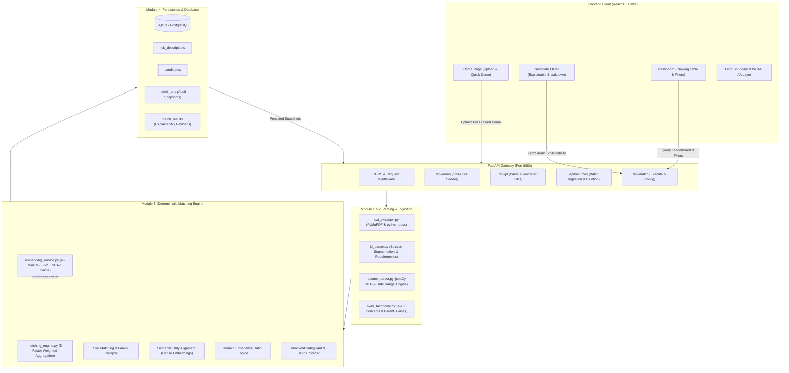
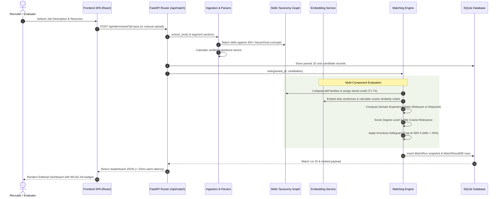
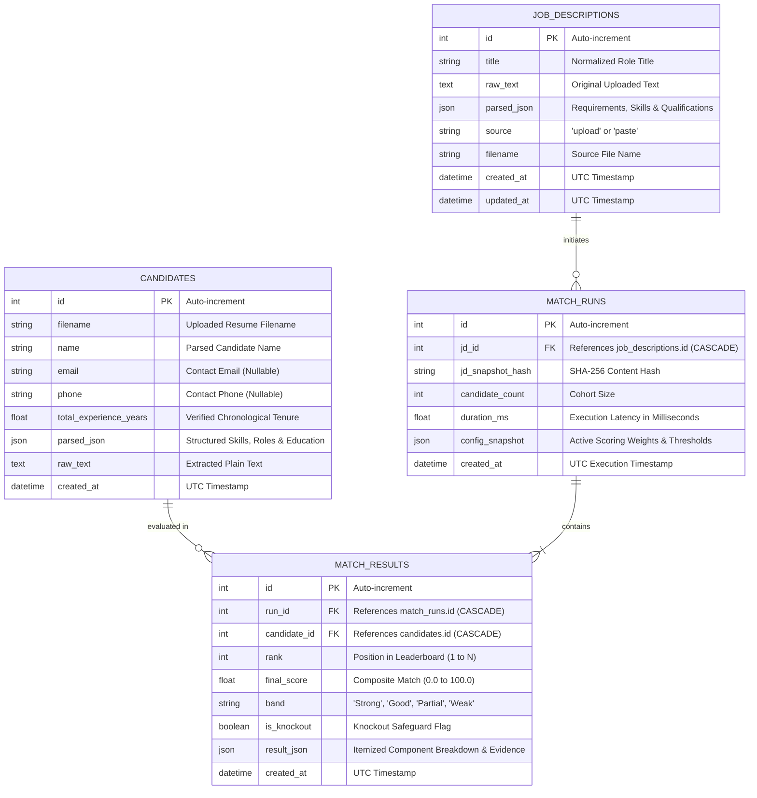

# System Architecture & Technical Design Specification

> End-to-end architectural blueprint, execution flowcharts, relational database schemas, and module responsibility mappings for the **AI-Based Resume Matching & Candidate Ranking System**.

---

## 1. High-Level System Architecture

The application adopts a decoupled, multi-tier client-server architecture. The frontend is a single-page application (SPA) built with React 18, Vite, and Tailwind CSS. The backend is a modular Python service powered by FastAPI, spaCy, PyMuPDF, and SentenceTransformers.

---

## 2. End-to-End Execution Sequence Flow

The diagram below illustrates the exact execution lifecycle from the moment a recruiter uploads files or clicks the one-click demo button to the final render of explainable candidate score cards.

---

## 3. Relational Database Schema (Entity-Relationship Diagram)

The database schema is designed for immutable audit tracking, candidate privacy, and cascade deletion.

---

## 4. Codebase Module & File Responsibility Mapping

The table below maps the functional responsibilities of every core module across the repository:

| Module | File Path | Primary Responsibilities |
| :--- | :--- | :--- |
| **Module 1: JD Parser** | [backend/app/services/jd_parser.py](file:///c:/Users/singh/OneDrive/Desktop/AI-Based%20Resume%20Matching%20%26%20Candidate%20Ranking%20System/backend/app/services/jd_parser.py) | Section segmentation, title extraction, required vs preferred skill isolation, experience range detection, degree classification, short JD warning generation. |
| **Module 2: Resume Parser** | [backend/app/services/resume_parser.py](file:///c:/Users/singh/OneDrive/Desktop/AI-Based%20Resume%20Matching%20%26%20Candidate%20Ranking%20System/backend/app/services/resume_parser.py) | Layout extraction, spaCy PERSON NER, contact heuristics, chronological interval union algorithm, stated experience capture, education degree mapping. |
| **Module 2b: Text Extractor** | [backend/app/services/text_extractor.py](file:///c:/Users/singh/OneDrive/Desktop/AI-Based%20Resume%20Matching%20%26%20Candidate%20Ranking%20System/backend/app/services/text_extractor.py) | PyMuPDF two-column layout detection, python-docx table & header extraction, Scanned PDF error detection, unicode ligature & date symbol normalization. |
| **Module 2c: Skills Taxonomy** | [backend/app/services/skills_taxonomy.py](file:///c:/Users/singh/OneDrive/Desktop/AI-Based%20Resume%20Matching%20%26%20Candidate%20Ranking%20System/backend/app/services/skills_taxonomy.py) | In-memory indexing of 420+ concept graph, synonym aliasing, parent concept resolution, and skill family lookups. |
| **Module 3: Matching Engine** | [backend/app/services/matching_engine.py](file:///c:/Users/singh/OneDrive/Desktop/AI-Based%20Resume%20Matching%20%26%20Candidate%20Ranking%20System/backend/app/services/matching_engine.py) | Multi-factor weighted composite scoring, Tier 1–4 skill credit, family collapse, semantic duty matrix cosine dot products, Knockout Safeguard enforcement. |
| **Module 3b: Embedding Service**| [backend/app/services/embedding_service.py](file:///c:/Users/singh/OneDrive/Desktop/AI-Based%20Resume%20Matching%20%26%20Candidate%20Ranking%20System/backend/app/services/embedding_service.py) | `all-MiniLM-L6-v2` SentenceTransformer wrapper, SHA-1 string cache, offline-first fallback, and cosine rescaling algorithms. |
| **Module 4: API & Persistence**| [backend/app/routers/](file:///c:/Users/singh/OneDrive/Desktop/AI-Based%20Resume%20Matching%20%26%20Candidate%20Ranking%20System/backend/app/routers/) | REST endpoints (`/api/jd`, `/api/resumes`, `/api/match`, `/api/demo`), SQLite relational transaction management, cascade pruning, and staleness detection. |
| **Module 5: Frontend UI** | [frontend/src/](file:///c:/Users/singh/OneDrive/Desktop/AI-Based%20Resume%20Matching%20%26%20Candidate%20Ranking%20System/frontend/src/) | React 18 editorial dashboard, Tailwind CSS design tokens, WCAG AA compliance, Error Boundary, StatTiles, ScoreBars, and responsive views. |

---

## 5. Architectural Decisions Reference (DECISIONS.md Summary)

The system's development was guided by 59 formal Architectural Decisions recorded in [DECISIONS.md](file:///c:/Users/singh/OneDrive/Desktop/AI-Based%20Resume%20Matching%20%26%20Candidate%20Ranking%20System/DECISIONS.md). The critical architectural choices include:

- **D1, D3, D5:** Local sentence embeddings (`all-MiniLM-L6-v2`) and deterministic mathematical models over cloud generative LLMs for sub-20ms speed, zero API costs, and strict GDPR compliance.
- **D4:** SQLAlchemy ORM with SQLite file storage for single-command developer setup, designed with complete PostgreSQL migration portability.
- **D12:** Skill Family Collapse to neutralize resume keyword stuffing.
- **D18:** Knockout Safeguard capping candidates with $<25\%$ core skills at 39% ('Weak match').
- **D28:** Cascade deletion ensuring deletion of candidate records prunes all foreign key match entries.
- **D48 (superseding D43):** Calibrating job title cosine similarity bounds from $[0.15, 0.70]$ to $[0.30, 0.75]$, strictly preventing cross-domain marketing or non-technical roles from receiving unearned title scores.
- **D51:** Frontend band consistency rule establishing backend `/api/match/config` as the absolute single source of truth for all score bands and thresholds.
- **D59:** Responsible AI protocol excluding all demographic attributes (gender, age, photo, ethnicity) from candidate scoring pipelines.
